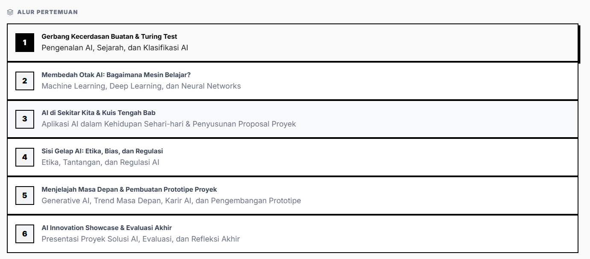
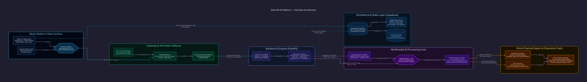

<div align="center">
  <br />
  <p align="center">
    
  </p>

  <h1 align="center">EduCraft AI</h1>
  <p align="center"><i>FULL-STACK MULTIMODAL QUESTION GENERATOR & CURRICULUM INTELLIGENCE PLATFORM</i></p>

  <a href="https://educraft.saitech.co.id" target="_blank">
    
  </a>
  <br />

  <p align="center">
    
    
    
    
    
    
    
    
    
  </p>

  <p align="center" style="max-width: 850px; font-size: 1.05rem; color: #94a3b8; line-height: 1.6;">
    <b>EduCraft AI</b> adalah platform rekayasa kecerdasan pedagogis end-to-end yang mengotomatisasi penyusunan instrumen evaluasi pendidikan berstandar Kurikulum Merdeka. Mengombinasikan arsitektur hybrid <b>Next.js 14 App Router</b>, microservice <b>FastAPI</b>, penalaran multimodal <b>Google Gemini AI</b>, dan persistensi terenkripsi <b>Supabase RLS</b>, EduCraft AI mengekstrak materi mentah lintas format (PDF, DOCX, PPTX, OCR) menjadi set soal terstruktur (Pilihan Ganda, Isian Singkat, Essay berbobot rubrik) lengkap dengan pembahasan, rumus matematika <b>KaTeX</b>, serta ekspor siap cetak <b>.docx (Kop Surat Resmi)</b> dan <b>PDF</b> dalam hitungan detik.
  </p>
</div>

<p align="center">
  
</p>

<p align="center"></p>

## 🏛️ Arsitektur Sistem Terdistribusi

Sistem beroperasi melalui pemisahan tanggung jawab (*Separation of Concerns*) berbasis microservice: layer presentasi frontend Next.js 14 menangani interaktivitas klien dan state PWA/Capacitor, sementara engine komputasi AI berjalan terisolasi pada backend asynchronous FastAPI yang berkomunikasi melalui internal API handshake.

<p align="center">
  
</p>

<p align="center"></p>

## ⚡ Inovasi Teknis Unggulan

<table align="center" width="100%">
  <tr>
    <td width="50%" valign="top">
      <b>📄 Multimodal Document Ingestion</b><br/>
      Engine ekstraktor file terpadu menggunakan <code>PyMuPDF</code> untuk dokumen PDF, <code>python-docx</code> untuk lembar Word, <code>python-pptx</code> untuk slide presentasi, dan <code>pytesseract</code> untuk optical character recognition (OCR) dari tangkapan layar buku cetak. Mendukung payload hingga <b>20MB</b> dengan normalisasi whitespace otomatis dan pembersihan noise artefak scan.
    </td>
    <td width="50%" valign="top">
      <b>🎯 Taksonomi Bloom & HOTS Reasoning</b><br/>
      Mesin perumusan soal memetakan konten ke dalam 6 tingkatan kognitif Taksonomi Bloom (<b>C1 Mengingat</b> hingga <b>C6 Mencipta</b>). Memisahkan kategori LOTS (<i>Lower Order Thinking Skills</i>) dan HOTS (<i>Higher Order Thinking Skills</i>) secara presisi, menyertakan stimulus kontekstual, opsi pengecoh homogen (*distractors*), kunci jawaban tervalidasi, serta rubrik penilaian bertingkat untuk soal essay.
    </td>
  </tr>
  <tr>
    <td width="50%" valign="top">
      <b>⚙️ Hybrid Microservice & Internal Gateway Handshake</b><br/>
      Frontend Next.js 14 dan FastAPI Python berjalan secara independen di bawah supervisi <code>PM2</code> (Next.js pada port <code>20180</code>, FastAPI pada port <code>8002</code>). Seluruh relay API antar-service dipagari header verifikasi <code>X-API-Key</code> internal yang mencegah pemanggilan engine langsung dari luar perimeter, dilengkapi CORS whitelist yang ketat.
    </td>
    <td width="50%" valign="top">
      <b>🖨️ Omni-Channel Production Document Export</b><br/>
      Hasil generate soal dapat langsung diekspor ke berkas Microsoft Word <code>.docx</code> melalui <code>docxtpl</code> yang menyuntikkan data ke template baku <code>template_ujian.docx</code> (lengkap dengan kop sekolah, mata pelajaran, alokasi waktu, dan lembar jawab) serta dokumen vektor <code>PDF</code> via <code>fpdf2</code> yang siap cetak tanpa perlu penyesuaian margin manual.
    </td>
  </tr>
  <tr>
    <td width="50%" valign="top">
      <b>📱 Universal Mobile Shell via Capacitor</b><br/>
      Konfigurasi runtime <code>capacitor.config.ts</code> membungkus aplikasi web ke dalam bundle aplikasi Android native (<code>com.educraft.ai</code>). Dilengkapi custom Splash Screen (1800ms fade), Dark Status Bar terintegrasi, penanganan offline fallback <code>offline.html</code>, serta caching service worker PWA yang responsif di jaringan terbatas.
    </td>
    <td width="50%" valign="top">
      <b>🏫 Smart Classroom Intelligence Suite</b><br/>
      Tidak hanya generator soal, platform menyediakan instrumen manajemen kelas lengkap: <b>Arena Kuis Interaktif (Play Mode)</b> untuk asesmen formatif real-time, <b>Modul Perencana Ajar (RPP Kurikulum Merdeka)</b> otomatis, modul <b>Koreksi Jawaban Siswa</b> cerdas, pembagi kelompok acak berbasis algoritma seimbang, dan <b>Sesi Rekap Absensi Terenkripsi</b>.
    </td>
  </tr>
</table>

<p align="center"></p>

## 📐 Spesifikasi Topologi Microservice & API Contracts

### Service Orchestration Matrix

| Service Component | Runtime / Stack | Port Lokal | Peran Arsitektur |
|---|---|:---:|---|
| **Web Client & Gateway** | Next.js 14, Node.js v20+, React 19 | `:20180` / `:3000` | Ingress traffic, SSR, JWT Guard, UI Dashboard |
| **AI Inference Engine** | FastAPI, Uvicorn, Python 3.11 | `:8002` | Generator kognitif, parsing file, export renderers |
| **Persistence Layer** | Supabase Managed Cloud (PostgreSQL 15) | `:5432` / HTTPS | Relational schema, Row Level Security, asset storage |
| **Reverse Proxy / Production** | Cloudflare Tunnel / PM2 Daemon | `:80` / `:443` | SSL Termination, public domain `educraft.saitech.co.id` |

### Core Backend API Endpoints (`ai-engine/`)

| Method | Endpoint | Payload / Params | Deskripsi Operasional |
|:---:|---|---|---|
| `POST` | `/api/generate` | `topik`, `tipe_soal`, `jumlah`, `kesulitan`, `level_bloom` | Merumuskan set soal terstruktur via Gemini AI |
| `POST` | `/api/parse-file` | `multipart/form-data` (PDF, DOCX, PPTX maks 20MB) | Ekstraksi teks & pembersihan noise dokumen |
| `POST` | `/api/export/docx` | `soal[]`, `header` (kop sekolah, mapel, durasi) | Render berkas Word `.docx` berbasis template ujian |
| `POST` | `/api/export/pdf` | `soal[]`, `header`, `sertakan_jawaban` | Render dokumen PDF siap cetak via `fpdf2` |
| `POST` | `/api/koreksi` | `soal[]`, `jawaban_siswa[]`, `kunci_jawaban[]` | Koreksi otomatis isian & essay berbobot rubrik |
| `POST` | `/api/perencana` | `mata_pelajaran`, `fase_kelas`, `alokasi_waktu` | Penyusunan Modul Ajar Kurikulum Merdeka |
| `POST` | `/api/absensi` | `kelas_id`, `tanggal`, `daftar_siswa[]` | Validasi kehadiran dan persistensi rekap |
| `GET` | `/health` | — | Probe kesiapan liveness dan readiness engine |

<p align="center"></p>

## 📂 Struktur Direktori Repositori

```text
educraft-ai/
├── app/                               # Next.js 14 App Router
│   ├── (auth)/                        # Route group autentikasi (login, register)
│   ├── (dashboard)/                   # Route group dashboard utama guru
│   │   ├── create/                    # Workspace generator soal interaktif
│   │   ├── library/                   # Repositori set soal & bank materi tersimpan
│   │   ├── play/                      # Live quiz arena mode interaktif siswa
│   │   ├── perencana/                 # Generator Modul Ajar (RPP Kurikulum Merdeka)
│   │   ├── koreksi/                   # Evaluator & pemeriksa jawaban siswa otomatis
│   │   └── absensi/                   # Pencatat & rekap sesi kehadiran kelas
│   ├── api/                           # Next.js internal API routes (authenticated relay)
│   ├── layout.tsx                     # Root layout dengan Font Plus Jakarta Sans & Theme
│   └── page.tsx                       # Landing page edukasi tingkat enterprise
├── ai-engine/                         # FastAPI Microservice Backend
│   ├── main.py                        # Uvicorn entry point, middleware API key & CORS
│   ├── run_pm2.py                     # Runner script untuk PM2 daemon
│   ├── requirements.txt               # Pustaka Python terpin (FastAPI, PyMuPDF, docxtpl)
│   ├── router/                        # Modular route controllers
│   │   ├── generate.py                # Pipeline generator soal Taksonomi Bloom
│   │   ├── parse_file.py              # Parsing multipart PDF, DOCX, PPTX
│   │   ├── export_docx.py             # Templating Word via docxtpl
│   │   ├── export_pdf.py              # PDF compiler via fpdf2
│   │   └── koreksi.py                 # Evaluasi jawaban siswa
│   ├── service/                       # AI Service Layer & Gemini SDK Handlers
│   ├── template/                      # Dokumen template baku ujian (template_ujian.docx)
│   └── tests/                         # Pytest test suites (test_parse_file, test_koreksi)
├── components/                        # Desain komponen UI taktil (Tailwind + Framer Motion)
├── lib/                               # Konfigurasi Supabase client & utility functions
├── supabase/                          # Database migrations & RLS SQL schemas
├── capacitor.config.ts                # Konfigurasi packaging Android Native Shell
├── ecosystem.config.js                # PM2 Production Multi-Process Orchestrator
├── docs/                              # Dokumentasi arsitektur D2 sumber (architecture.d2)
├── assets/                            # Kompilasi aset vektor SVG & hero screenshot preview
└── LICENSE                            # Lisensi Open-Source MIT (Luthfi Muthathohirin)
```

<p align="center"></p>

## 🚀 Panduan Eksekusi & Instalasi Lokal

### 1. Prasyarat Sistem
- **Node.js**: `v20.x` atau lebih tinggi
- **Python**: `v3.11.x`
- **Tesseract OCR Engine** *(Opsional, untuk ekstraksi gambar)*
- **Akun Supabase** (URL & Anon Key)
- **Google Gemini API Key**

---

### 2. Konfigurasi Lingkungan (`.env.local`)
Salin berkas `.env.example` ke `.env.local` pada root project:
```bash
cp .env.example .env.local
```
Lengkapi variabel lingkungan minimum:
```env
# Frontend & Auth Configuration
NEXT_PUBLIC_APP_URL="http://localhost:3000"
NEXT_PUBLIC_SUPABASE_URL="https://your-project.supabase.co"
NEXT_PUBLIC_SUPABASE_ANON_KEY="your-anon-key"

# AI Engine Inter-Service Communication
AI_ENGINE_URL="http://127.0.0.1:8002"
AI_ENGINE_API_KEY="dev-key-educraft"

# AI Model Configuration
OPENAI_API_KEYS="your-gemini-or-openai-api-key"
OPENAI_BASE_URL="https://generativelanguage.googleapis.com/v1beta/openai/"
OPENAI_MODEL="gemini-1.5-flash"
```

---

### 3. Menjalankan Backend AI Engine (FastAPI)
```bash
cd ai-engine
python -m venv .venv

# Windows (Git Bash / PowerShell)
source .venv/Scripts/activate

# Instal dependensi
pip install -r requirements.txt

# Jalankan server development
uvicorn main:app --host 127.0.0.1 --port 8002 --reload
```
Akses OpenAPI Documentation di `http://127.0.0.1:8002/docs`.

---

### 4. Menjalankan Frontend Web (Next.js 14)
Buka terminal baru di root direktori repositori:
```bash
npm install
npm run dev
```
Akses antarmuka web di browser pada `http://localhost:3000`.

---

### 5. Mode Produksi via PM2
Platform dilengkapi berkas orkestrasi `ecosystem.config.js` untuk menjalankan frontend dan backend secara simultan di latar belakang:
```bash
pm2 start ecosystem.config.js
pm2 status
```

<p align="center"></p>

## 🛡️ Jaminan Keamanan, Audit & Lisensi

- **Audit Kredensial Bersih (Gitleaks v8.30.1):** Seluruh 117 commit riwayat repositori telah dipindai secara menyeluruh dan mencatat **0 temuan kebocoran rahasia**.
- **Perlindungan Kredensial Ketat (`.gitignore`):** Aturan penyaringan telah mengunci berkas `.env*`, mobile signing keystores (`*.jks`, `*.keystore`), private keys (`*.key`, `*.pem`), serta local database dumps dari staging git.
- **Isolasi Data Siswa:** Supabase PostgreSQL menerapkan **Row Level Security (RLS)** ketat di mana setiap data materi dan set soal hanya dapat diakses oleh user pemilik session token JWT yang valid.
- **Lisensi Hukum Sah:** Dilisensikan di bawah **MIT License**. Hak cipta penuh dipegang oleh **Luthfi Muthathohirin** (`@HyLuthfi`). Lihat berkas [`LICENSE`](LICENSE) untuk detail legal lengkap.

---

<div align="center">
  <p style="font-size: 0.95rem; color: #64748b;">
    Dirancang & Dibangun oleh <b>Luthfi Muthathohirin</b> (<a href="https://github.com/HyLuthfi">@HyLuthfi</a>)<br/>
    Bagian dari Inisiatif EduTech & Ekosistem AI <b>SAI Tech</b> (<a href="https://saitech.co.id">saitech.co.id</a> · <a href="https://saitech.uno">saitech.uno</a>)
  </p>
</div>


